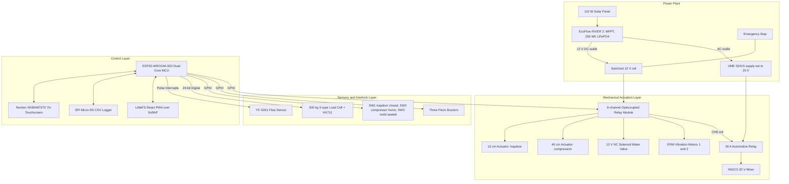

# AUTOBRIQ: DEVELOPMENT OF A FULLY AUTOMATED PAPER-CHARCOAL BRIQUETTE MACHINE

> **Bachelor of Science in Computer Engineering (BSCpE) Thesis Project**  
> **Faculty of Computer Engineering | Polytechnic University of the Philippines, Sta. Mesa, Manila**  
> _Study areas: Barangay Anglas and Barangay Poblacion, Cavinti, Laguna, Philippines (off-grid communities)_

---

## Executive Research Summary

This repository holds the firmware, dashboards and documentation for **AUTOBRIQ**, a solar-powered, **fully automated** paper-charcoal briquette machine. The operator selects the water level, loads shredded paper and crushed charcoal, inserts the mold and presses START. From there the ESP32 runs water dispensing, soaking and mixing, gravity discharge into a partitioned mold, compression molding and press retraction on its own, using timers, sensor feedback and safety interlocks, with no mid-cycle prompts. The operator then pulls out the mold.

The machine cycle **ends after compression and press retraction**. There is no thermal drying in the machine: the briquettes are air-dried outside it, so the machine is free for the next batch sooner. Each batch targets **at least 20 solid rectangular briquettes** of one fixed size.

```
+---------------------------------------------------------------------------------------------------+
|                                 CIRCULAR ECONOMY VALUE CHAIN                                      |
|                                                                                                   |
|  [Waste Paper]          ---> Shred & Soak ----> Hydrated Cellulose Fibers (natural binder)        |
|  [Charcoal Fines]       ---> Load into hopper -> Mixed into a paper-charcoal slurry               |
|  [Water]                ---> Flow-metered   ---> Preset volume (30% to 100% of the container)     |
|  [Solar PV + EcoFlow]   ---> 110 W panel -> RIVER 2 power station (MPPT, 256 Wh LiFePO4)          |
|                                                                                                   |
|  ====> OUTPUT: pressed rectangular briquettes (>= 20 per batch), air-dried outside the machine    |
+---------------------------------------------------------------------------------------------------+
```

The source of truth for every design decision is the thesis. Its text is in [`chapters/AUTOBRIQ_fully_automated_thesis.md`](chapters/AUTOBRIQ_fully_automated_thesis.md); what is built and where the build still differs from it is tracked in [`docs/PROJECT_CONTEXT.md`](docs/PROJECT_CONTEXT.md).

---

## How a Batch Runs (five modules)

| # | Module | What happens |
|---|--------|--------------|
| 1 | **Initialization, loading, batch start** | Mount LittleFS and the SD card, start the Wi-Fi AP and PWA, init the Nextion, self-test (interlocks closed, actuators home, power present). Setup screens: paper plus water level (30% to 100%, preset 100%), then charcoal, then START. |
| 2 | **Water dispensing and mixing** | The normally closed valve opens and the YF-S201 pulse count meters the volume, then the valve closes. The mixer runs for a preset time into a homogeneous slurry. |
| 3 | **Mixture discharge** | The mixer stops. The 15 cm actuator retracts to open the container's trapdoor while ERM motor 1 shakes the remaining mixture down; the actuator then closes the trapdoor (SW1 confirms). |
| 4 | **Leveling and compression** | ERM motor 2 levels the mixture. With SW1 and SW3 confirmed, the 40 cm actuator presses into the partitioned mold while the HX711 reads the 300 kg load cell; the extend relay turns off at the preset force threshold. |
| 5 | **Retraction and unload** | The actuator retracts to home (SW2). The batch record (runtime, water level, dispensed volume, peak force) is saved to the SD card as a CSV row and pushed to the PWA. The buzzer sounds and the screen asks the operator to remove the mold. |

---

## Repository Structural Map

| Path | Description |
|------|-------------|
| [`chapters/AUTOBRIQ_fully_automated_thesis.md`](chapters/AUTOBRIQ_fully_automated_thesis.md) | **Current thesis text** (Chapters 1 to 3, October 2026): the source of truth. The original `.docx` with figures is kept outside git. |
| [`chapters/`](chapters/) (older files) | **Superseded** semi-automated thesis, kept for history only. See [`chapters/README.md`](chapters/README.md). |
| [`docs/`](docs/) | Filled document suite: BRD, PRD, DSD, SDD, QAD, CLR, GTM and the Nextion HMI guide. Start with [`docs/PROJECT_CONTEXT.md`](docs/PROJECT_CONTEXT.md). |
| [`docs/guides/`](docs/guides/) | Wiring and test guides as HTML: whole-system wiring and perfboard layout, test rig, solenoid valve, YF-S201 flow sensor, load cell. |
| [`agent.md`](agent.md) | Rules and shared parameters for agents and contributors editing the docs. |
| [`operator-node/`](operator-node/) | ESP32 firmware (`src`, `include`), bench-test sketches (`actuator-test`, `hmi-test`, `hmi-bridge`) and the React PWA (`dashboard`). |
| [`mockups/`](mockups/) | Pixel mockups of the PWA and the Nextion screens. |

> The final operator interfaces (the Nextion dashboard and the React PWA) must not be deleted or rewritten wholesale. See [`agent.md`](agent.md) Rule 6.

---

## Material Science: Cellulose Adhesion & Mix Design

The briquettes bind with **no synthetic adhesive**: soaked paper breaks down into pulp, and its hydrated cellulose fibers interlock with the charcoal fines under compression.

```
CELLULOSE FIBER WETTING, SWELLING, AND HYDROGEN BOND FORMATION

Dry Paper Fiber          Soaked & Hydrated           Compacted
[ -OH ... HO- ]  ===>   [ -OH  (H2O)  HO- ]  ===>    [ -OH-O-H ... O-H-O- ]
Intra-chain H-bonds      Fiber Swelling              Inter-chain H-bonds
(Crystalline)             (Amorphous Activation)       (Mechanical Interlock)
```

- **Water Retention Value (WRV):** Kraft paper holds a WRV of **1.0 to 1.2** (it keeps its water even under compression).
- **Water Holding Capacity (WHC):** Charcoal fines hold a WHC of **2.0 to 3.0**.
- **Mix ratio:** The goal is paper : charcoal = **1 : 1** by weight, which gives a wet mixture of charcoal : paper : water from **1.0 : 1.0 : 3.0** to **1.0 : 1.0 : 4.2**.

| Material | Initial Wet Mix | Final Dried Briquette (after air-drying outside the machine) |
|----------|-----------------|---------------------------------------------------------------|
| Paper waste | 16.13% to 20% | 50% |
| Residual charcoal fines | 16.13% to 20% | 50% |
| Water | 67.7% to 60% | 0% |
| **Total** | **100%** | **100%** |

The machine only removes water mechanically, by compression. Residual moisture after the press is reduced by air-drying and is not a controlled variable.

---

## Cyber-Physical System (CPS) Architecture



### Component Specifications (Thesis Tables 6 to 9)

#### 1. Central Processing, HMI and Storage

- **Microcontroller:** ESP32-WROOM-32D, dual core, FreeRTOS. Per the thesis, Core 0 handles hardware ISRs and fail-safe interlocks; Core 1 handles the networking stack, the Wi-Fi AP and WebSocket telemetry.
- **Touchscreen:** Nextion NX8048T070, 7.0", UART. Batch start, process status, water-volume and force readings, fault notifications.
- **Storage:** SPI Micro-SD (FAT32) for the append-only CSV batch log; LittleFS in internal flash for the PWA assets.

#### 2. Power Infrastructure (Off-Grid)

- **Solar array:** 110 W monocrystalline panel.
- **Power station:** EcoFlow RIVER 2: 256 Wh LiFePO4, built-in MPPT charge controller (up to 110 W solar input), 300 W AC outlet, 12.6 V / 8 A (100 W max) DC outlet.
- **Mixer supply:** UME S2415 switching supply (24 V, 15 A) adjusted to 20 V DC, fed from the AC outlet and switched by a 30 A automotive relay.
- **Actuator and control circuits:** from the DC outlet, through the emergency stop.

#### 3. Electromechanical Actuators & Fluidics

- **Linear actuators:** two 12 V actuators rated 1,500 N at 7 mm/s: **15 cm** (mixing-container trapdoor) and **40 cm** (compression). Two relay channels each set the direction.
- **Mixer:** INGCO MXLI2001 20 V paddle mixer, 0 to 650 rpm.
- **Water valve:** 12 V DC normally closed solenoid valve, closed by the flow-sensor count.
- **Vibration:** two 12 V ERM motors: ERM 1 on the mixing container (discharge), ERM 2 on the compression box (leveling).
- **Relay module:** 8-channel, 10 A, optocoupled. CH1 to CH4 actuator directions, **CH5 water valve**, **CH6 automotive relay (mixer)**, CH7 and CH8 spare.

#### 4. Sensing, Interlocks and Signalling

- **Force:** 300 kg S-type load cell with an HX711 24-bit ADC on the compressor block.
- **Water:** YFS-201G1 Hall-effect flow sensor, pulse counted by interrupt.
- **Position:** three roller-lever switches: SW1 trapdoor closed, SW2 compressor home, SW3 mold seated.
- **Safety:** red mushroom emergency stop (cuts the switched 12 V; controller and screen stay powered), 1N4007 flyback diodes, decoupling capacitors, IP65 enclosure, common ground terminal block (14 AWG power, 22 AWG signal).
- **Signalling:** three piezo buzzers for process boundaries and faults.

---

## Sensor Calibration & Mathematical Models

### 1. YF-S201 Water Flow Sensor

Integrates the pulse count to the dispensed volume:
$$V_w = \frac{P}{C_{\text{flow}}}$$

- **Calibration constant:** the project used **450 pulses per liter** from earlier gravimetric testing. Re-check it against a measuring jug on the assembled machine before relying on it; the thesis requires the valve to close at the preset volume from this count.
- **Flow Velocity Equation:** $Q = 0.00222 \cdot f + 0.015\ \text{L/min}$ (where $f$ is the pulse frequency in Hz).

### 2. Compaction Load Cell (HX711)

Converts the 24-bit reading to force:
$$F\ (\text{N}) = \frac{ADC_{\text{raw}} - ADC_{\text{tare}}}{k} \times 9.80665$$

- **Scale factor $k$:** an earlier calibration measured about **22,480 LSB/kg** with the cell excited at 5 V. Excitation voltage changes this, so **recalibrate with a known weight** on the final wiring (the bench rig runs the HX711 from 3.3 V).
- **Force threshold:** set by calibration before performance testing, and always **below the 1,500 N thrust** of the 40 cm actuator. The extend relay turns off when the reading reaches it. The thesis does not fix a number.

---

## Power Notes

The off-grid design is a 110 W panel charging the EcoFlow RIVER 2, which supplies the 12 V circuits and the mixer supply. Energy per batch has not been measured yet: log the Wh used per batch before claiming how many batches one charge gives. The thesis names two limits: operation depends on solar irradiance (prolonged overcast weather can interrupt operation), and the machine draws power only from this system.

---

## Quantitative Verification Framework

The thesis evaluates the machine against a manual baseline and against store-bought charcoal:

- **Mean (manual baseline, burn duration, heat retention):**
  $$\bar{x} = \frac{\sum_{i=1}^{n} x_i}{n}$$
- **Consistency of output (mass and dimensions, 30 specimens):**
  $$\sigma = \sqrt{\frac{\sum_{i=1}^{n} (x_i - \bar{x})^2}{n}}$$
- **Production rate (units per hour):**
  $$R = \frac{U}{T}$$
- **Labor and time reduction (percentage, equal quantities):**
  $$\%\text{ Reduction} = \frac{\bar{T}_{\text{manual}} - \bar{T}_{\text{automated}}}{\bar{T}_{\text{manual}}} \times 100$$
- **Shatter resistance index (1 m drop test):**
  $$\%\text{ Weight Loss} = \frac{W_i - W_o}{W_i} \times 100$$
  _(where $W_i$ is the initial weight and $W_o$ the weight of the largest remaining piece)._
- **Acceptability:** weighted mean of a 5-point Likert ISO 25010 questionnaire given to 15 end-users.

Batch yield is counted against the target of at least 20 briquettes per batch.

---

## Build & Deployment Instructions

### 1. ESP32 Firmware

Install **PlatformIO** in VS Code. Environments in `operator-node/platformio.ini`:

| Environment | Purpose |
|-------------|---------|
| `esp32doit-devkit-v1` | Main firmware (batch FSM, Nextion dashboard, SoftAP and PWA server). Relay outputs are simulated until `OUTPUTS_LIVE` is enabled. |
| `actuator-test` | Bench-test sketch that drives the real relays from the Nextion, a phone, or serial (also the HX711 load cell). |
| `nextion-test`, `nextion-bridge` | Display bring-up and a USB to Nextion serial bridge. |

```bash
cd operator-node
pio run -e esp32doit-devkit-v1 -t upload
```

### 2. Nextion Display

No custom `.HMI` or `.tft` flash is needed. The firmware draws every screen at runtime on the NX8048T070 (800 x 480) with Nextion drawing commands and takes over the factory demo project. The Nextion boots at 9600 baud and the ESP32 switches it to 115200. See [`docs/Nextion_HMI_Design.md`](docs/Nextion_HMI_Design.md) and the pixel mockups in [`mockups/nextion/`](mockups/nextion/).

### 3. PWA Web Interface

The PWA is served from the ESP32's internal LittleFS partition and must not load anything from a CDN:

```bash
cd operator-node/dashboard
npm install
npm run build        # outputs to operator-node/data

cd ..
pio run -e esp32doit-devkit-v1 -t uploadfs
```

Join the machine's Wi-Fi (`Operator-Node-01`) and open `http://192.168.4.1`.

---

## Safety Protocols & Multiple Constraints

1.  > [!IMPORTANT]
    > **Operator involvement is limited** to selecting the water level, loading the paper and crushed charcoal when prompted, inserting the mold, pressing START, and removing the mold at the end. Every stage in between is automatic, with no mid-cycle prompts.
2.  > [!CAUTION]
    > **Interlocks and emergency stop:** limit switches SW1 (trapdoor), SW2 (compressor home) and SW3 (mold seated) gate the cycle. An unexpected trapdoor opening, mold removal, invalid force reading or compression timeout stops the production loads and raises a fault. The emergency stop cuts the switched 12 V to the actuators and valve while the controller and screen stay powered.
3.  > [!WARNING]
    > **Material restriction:** the machine processes exactly three inputs (paper waste, charcoal fines, water) and cannot extract water-insoluble impurities from the paper; they stay in the briquette.
4.  > [!IMPORTANT]
    > **Power boundary:** the machine runs entirely off-grid from the 110 W solar panel and the EcoFlow RIVER 2.
5.  > [!NOTE]
    > **Batch and geometry limits:** one fixed rectangular-prism briquette size; a new batch needs the previous cycle finished, the filled mold removed and an empty, correctly seated mold inserted. Compaction is hard-capped by the 1,500 N actuator thrust.
6.  > [!NOTE]
    > **Network limits:** a local edge node with no internet; the SoftAP is reliable for about 4 to 5 phones; the PWA is fully self-contained with no external CDNs.

---

## Current Build Status

Firmware and dashboards are built and run on a bench rig; the main firmware still simulates its relay outputs and sensors. Limit switches, buzzers and SD logging are not implemented in firmware yet. The complete, dated list of what is built and where it differs from the thesis is in [`docs/PROJECT_CONTEXT.md`](docs/PROJECT_CONTEXT.md).

---

> 🎓 **Academic Proponents & Citation:**  
> Developed by the Computer Engineering research team at the Polytechnic University of the Philippines:  
> **Gero B. Añonuevo, Gerald S. Berongoy, Marco Gabriel P. Galdiano, and Jester Carl C. Tiedra.**  
> Under the guidance and supervision of the **Faculty of Computer Engineering, PUP Sta. Mesa, Manila.**
