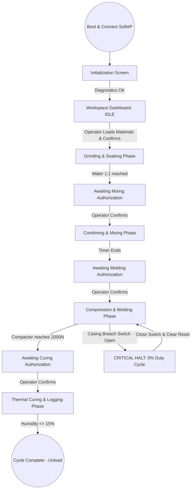

# Product Requirements Document (PRD)

**Project:** Semi-Automated Paper-Charcoal Briquette Machine Dashboard
**Date:** 2026-06-03
**Version:** 1.0.0
**Owner:** PUP Computer Engineering Group 6 (Añonuevo, Berongoy, Galdiano, Tiedra)
**Status:** In Review
**BRD:** [BRD_Template.md](BRD_Template.md)

---

## 1. Product Purpose & Value Proposition

The dashboard is a Progressive Web App (PWA) hosted directly on the ESP32's local Access Point via its internal LittleFS storage, functioning entirely off-grid without internet access. It acts as the wireless Human-Machine Interface (HMI) and telemetry hub for the semi-automated paper-charcoal briquette machine. The PWA provides real-time monitoring of the machine's 5-stage finite state machine (FSM), displaying critical parameters such as grinding amperage, water flow volume, mixing timer progress, compaction force (0–2000N), drying enclosure climate conditions, and solar-battery health. By establishing an offline wireless connection, the PWA enables operators to safely authorize workflow stage transitions and monitor operations from a mobile device, protecting them from physical hazards associated with mechanical compaction and high-torque motors.

---

## 2. Target Personas

**Primary Persona — Mang Jun (Community Operator)**
*   *Who they are:* A 48-year-old community cooperative worker in rural Cavinti, Laguna. He has limited technical training and relies on a budget Android smartphone. He operates the machine in high-vibration, noisy, and outdoor sun-glare environments.
*   *Their core frustration:* "Industrial machinery is too complicated and dangerous to run. I am afraid of making a mistake that ruins the batch, stalls the motor, or causes an injury during compaction."
*   *What success looks like for them:* A highly visual, simple mobile interface with large touch buttons, clear progress steps, and prominent safety alerts that tell him exactly when to load raw materials, when to press, and when the batch is ready.

**Secondary Persona — Engr. Sarah (LGU Environmental Officer)**
*   *Who they are:* An environmental manager tracking local solid waste reduction.
*   *Their core frustration:* "I have no data on how much alternative fuel the community is actually producing or how stable the solar power bank is during consecutive batches."
*   *What success looks like for them:* An easy-to-read dashboard detailing solar charging efficiency, battery state of charge (SoC), and the ability to view/export standalone CSV run records stored on the machine's SD card.

---

## 3. Core Features & Priorities

Must-Have = Local PWA Telemetry & Control (V1 Release).

| Feature | Description | Priority |
|---------|-------------|----------|
| **FSM Stage Telemetry Hub** | Renders the active operational phase (1 to 5) with a linear progress bar and visual step guide. | Must-Have |
| **Real-time Sensory Gauges** | Renders live data: compaction force (HX711, 0–2000N limit), water volume (YF-S201, liters), and curing enclosure climate (DS18B20/DHT22). | Must-Have |
| **Stage Transition Gates** | Large, interactive confirmation panels allowing the operator to authorize mixing, molding, and drying transitions. | Must-Have |
| **Fail-safe Visual Interlocks** | Prominent warnings and automatic overlays displaying safety limit switch statuses and casing breach alerts. | Must-Have |
| **Solar & Battery Health HUD** | Renders battery voltage, solar input current, and system power state to verify off-grid resource capacity. | Should-Have |
| **CSV Run Log Viewer** | Renders past batch metrics (weight, moisture levels, runtime) appended directly onto the local Micro-SD card. | Should-Have |
| **Audio-Visual Prompts** | Syncs visual alerts with on-board buzzer signals to prompt physical operator actions (e.g., "Transfer Briquettes"). | Should-Have |

---

## 4. User Stories & Acceptance Criteria

**US-01 — Process State Progress Tracking**
> As a community operator, I want to see the active stage of the briquetting process so that I know what physical actions to take next.

Acceptance Criteria:
*   Given the machine is booted and connected, when a phase (e.g. Grinding/Soaking) is active, then the PWA shows a horizontal progress bar highlighting the active step with text describing the current process.
*   Given the active phase finishes, when the system transitions to the idle wait state, then a blinking action prompt is shown on the dashboard and the on-board buzzer sounds.

**US-02 — Compaction Load Monitoring**
> As a community operator, I want to monitor the exact compaction force applied by the linear actuator so that I know the machine is operating within safe physical limits.

Acceptance Criteria:
*   Given the Compression and Molding Phase is running, when the actuator drives downward, then the PWA displays a dynamic gauge showing force in Newtons (N) updated every 200 ms.
*   Given the load cell reaches the target limit, when the sensor registers 2000N, then the gauge turns solid green, the actuator halts, and the transition confirmation panel is unlocked.

**US-03 — Casing Breach Safety Override**
> As a community operator, I want the dashboard to immediately alert me and halt the actuator if a casing breach or safety interlock is triggered.

Acceptance Criteria:
*   Given the actuator is in motion, when the physical safety limit switch detects a casing breach, then the PWA flashes a fullscreen red alert overlay, displays "CRITICAL BREACH: ACTUATOR HALTED", and disables all manual control buttons.
*   Given the breach is resolved and the switch closed, when the operator presses "RESET FAULT" on the screen, then the overlay disappears and normal operation resumes.

**US-04 — Environmental Curing Termination**
> As a community operator, I want to see the curing relative humidity level so that I don't waste battery power running the halogen dryer once the briquettes are fully dried.

Acceptance Criteria:
*   Given the Thermal Curing Phase is active, when the DHT22 relative humidity sensor outputs a value, then the PWA displays the drying humidity percentage.
*   Given the exhaust relative humidity falls to 15%, when that threshold is met, then the system terminates the halogen relay, turns off the exhaust fan, displays "CURING COMPLETE", and logs the run metrics.

---

## 5. App Flow & UX Intent

### 5.1 Screen Inventory

| Screen | Purpose | Entry points | States to design |
|--------|---------|--------------|------------------|
| **Workspace Dashboard** | Primary control hub; renders FSM progress, sensor gauges, and active step authorization panels. | App launch | loading / idle / active-run / safety-halt |
| **Power & System Health**| Displays battery SoC, solar panel input, CPU frequency, and filesystem status. | Navbar tab | loading / normal-charge / high-draw / low-power |
| **History Run Logs** | Renders past batch production runs retrieved from the SD card. | Navbar tab | loading / empty-logs / success-list / write-error |

---

### 5.2 App Flow

### 5.3 Onboarding Flow
*   **Aha / first-value moment:** Opening `http://192.168.4.1` on any mobile browser immediately renders the offline dashboard showing the active ESP32 diagnostics and connection state without requiring signups or configurations.
*   **Time-to-first-value target:** < 10 seconds (time to connect to SoftAP and open the URL).
*   **Friction budget:** 0 setup steps. The PWA is served completely pre-packaged in LittleFS.

### 5.4 UX Constraints
*   **Consolidated UI Panels:** Every step displays its own focal action button; operators are never presented with multiple primary triggers on the same screen to prevent operational errors.
*   **Large Touch Targets:** Minimum button size is `48x48px` to facilitate error-free operation even when fingers are wet or soiled from material mixing.
*   **No Silent Failures:** Any sensor disconnection (DHT22, DS18B20, or HX711) triggers a visible yellow warning badge beside its gauge.

---

## 6. Out of Scope for This Release

*   **Remote Web Analytics:** Because the system operates as a local edge node without cellular internet connection, remote tracking is deferred.
*   **Automated Slurry Wetness Compensation:** The system counts volumetric water flow, but manual paper sorting remains necessary to maintain raw material consistency.

---

## 7. AI / Agent Feature Specifications

N/A — no AI component in this release. All control logic is governed by deterministic physical sensor boundaries and FreeRTOS state execution on the ESP32.

---

## 8. Dependencies & Assumptions

**Dependencies:**
*   **LittleFS Stability:** The ESP32 partition must mount successfully on boot to serve the React assets.
*   **Local Hardware Interrupts:** High-speed interrupts for the YF-S201 Hall-Effect sensor must remain unaffected by network tasks.

**Assumptions:**
*   Operators will connect directly to the ESP32 Access Point (`Operator-Node-01`) within a 15-meter range of the machine.
*   The LiFePO4 battery pack holds sufficient charge to power the 50W Halogen arrays during thermal curing batches.

---

## 9. Implementation Plan

| # | Phase / Milestone | Entry criteria | Exit criteria (Definition of Done) | Deliverable | Depends on | Owner (DRI) | Top risk |
|---|-------------------|----------------|-------------------------------------|-------------|------------|-------------|----------|
| M0 | PWA Core Setup | Install `vite-plugin-pwa` | React app builds, outputting `sw.js` and `manifest.json`. | PWA-compliant build folder | — | Añonuevo | Build files exceed LittleFS storage limits |
| M1 | Hardware Integration | Sensory drivers active on ESP32 | ESP32 endpoints `/api/stats` output real-time sensor JSON. | C++ firmware + API handler | M0 | Berongoy | Compactor noise corrupts I2C readings |
| Launch | Pilot Testing | PWA and ESP32 integrated | 30 successful briquette runs completed under 1 hour each. | Operational cyber-physical system | M1 | Galdiano | Wet hands disrupt touchscreen responsiveness |

**Rollout strategy:**
Phased deployment starting with cooperative members in Cavinti. Initial runs will be supervised directly by the engineering team before handing over full operational control.

**Rollback plan:**
*   *Trigger criteria:* A sensor read failure (e.g. compactor failing to halt at 2000N or safety switch bypass failure).
*   *Revert mechanism:* The physical emergency stop button on the machine chassis physically cuts power to all 12V motor lines, bypassing the microcontroller logic entirely.

---

## Self-Check

- [x] Every Must-Have feature in Section 3 has at least one user story in Section 4
- [x] Acceptance criteria are testable (Given/When/Then format)
- [x] Section 5.1: every interactive surface defines empty / loading / error / success states
- [x] Section 5.2: flow has no unintended dead ends; entry, exit, and edge cases annotated
- [x] Section 6 explicitly names things that were discussed but cut
- [x] Section 7 marked N/A
- [x] Section 9 covers all phases through post-launch
- [x] Section 9 has an explicit rollback trigger and revert mechanism
- [x] Section 9: every milestone has entry + exit criteria and one DRI
- [x] This document answers *what* to build, not *how* (architecture goes in the SDD)

---

*Next in sequence: [DSD](DSD_Template.md) → [SDD](SDD_Template.md) → [QAD](QAD_Template.md).*
