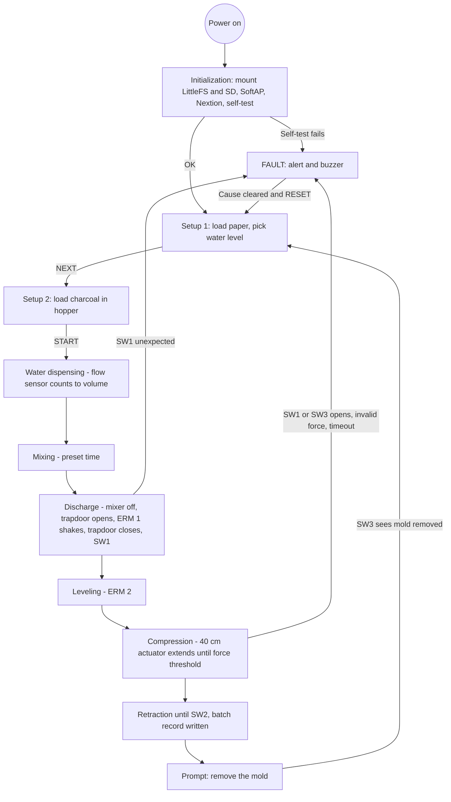

# Product Requirements Document (PRD)

**Project:** AUTOBRIQ Operator Interfaces (Nextion touchscreen + PWA dashboard)
**Date:** 2026-10-19
**Version:** 1.1.0
**Owner:** PUP Computer Engineering Group 6 (Añonuevo, Berongoy, Galdiano, Tiedra)
**Status:** In Review
**BRD:** [BRD_Template.md](BRD_Template.md)

---

## 1. Product Purpose & Value Proposition

AUTOBRIQ has two operator interfaces, both driven by the same ESP32 batch state machine. The **Nextion 7" touchscreen** on the machine handles batch setup and start, process status, water-volume and compression-force readings, and fault notifications. The **Progressive Web App (PWA)** is hosted on the ESP32's local Access Point from its internal LittleFS storage, works with no internet, and gives wireless monitoring, batch status and CSV downloads from a phone. Once the operator presses START, the machine runs water dispensing, mixing, discharge, leveling, compression and retraction **on its own**: there are no mid-cycle confirmations. The interfaces show what is happening and where it stops if something goes wrong, so the operator can keep a safe distance from the moving actuators and the mixer.

---

## 2. Target Personas

**Primary Persona: Mang Jun (Community Operator)**
*   *Who they are:* A 48-year-old community cooperative worker in rural Cavinti, Laguna. He has limited technical training and a budget Android phone. He works in a noisy, outdoor, sun-glare environment.
*   *Their core frustration:* "Industrial machinery is too complicated and dangerous to run. I am afraid of making a mistake that ruins the batch or hurts someone."
*   *What success looks like for them:* Few decisions: pick the water level, load paper and charcoal when asked, insert the mold, press START, take the mold out at the end. Large buttons, plain status messages, and loud, unmistakable fault signals.

**Secondary Persona: Engr. Sarah (LGU Environmental Officer)**
*   *Who they are:* An environmental manager tracking local solid waste reduction.
*   *Their core frustration:* "I have no data on how much alternative fuel the community is producing."
*   *What success looks like for them:* A dashboard with batch status and the ability to download the CSV batch records from the machine's SD card.

---

## 3. Core Features & Priorities

Must-Have = what the thesis names as interface functions (V1).

| Feature | Description | Priority |
|---------|-------------|----------|
| **Guided Batch Setup** | Two loading screens: paper plus water level (30% to 100%, preset 100%), then charcoal in the hopper, then START. | Must-Have |
| **Automatic Cycle Status** | Shows the active step of the automatic cycle with a progress indicator and a plain description. No operator authorization between steps. | Must-Have |
| **Live Sensor Readings** | Dispensed water volume (YF-S201, liters) and compression force (HX711 + 300 kg load cell, N) during the run. | Must-Have |
| **Fault and Interlock Alerts** | Full-screen fault state, on-screen message and buzzer when an interlock opens, a force reading is invalid, or a step times out. | Must-Have |
| **Emergency Stop Handling** | STOP and RESET controls; hardware E-stop cuts switched 12 V while the controller and screen stay powered. | Must-Have |
| **Mold Removal Prompt** | After retraction: buzzer plus a prompt to remove the pull-out mold. The system returns to setup when the mold is detected as removed. | Must-Have |
| **Batch Records (CSV)** | Runtime, selected water level, dispensed volume and peak compaction force saved to the SD card and pushed to the PWA. | Must-Have |
| **Power Health View** | Battery and solar status, SoftAP clients, CPU and filesystem state. | Should-Have |
| **CSV Download** | PWA downloads the batch records over the local Wi-Fi. | Should-Have |
| **Audio-Visual Prompts** | Three buzzers sound at process boundaries and faults, in step with the on-screen message. | Should-Have |

---

## 4. User Stories & Acceptance Criteria

**US-01: Batch Setup and Start**
> As a community operator, I want to choose the water level, load the materials when prompted and start the batch so that the machine does the rest by itself.

Acceptance Criteria:
*   Given the machine has booted and passed its self-test (interlocks closed, actuators home, power present), when the operator opens setup, then the screen shows the paper prompt and a 30% to 100% water selector preset to 100%.
*   Given the operator presses NEXT then START, when the cycle begins, then no further confirmation is requested until the mold-removal prompt.

**US-02: Process Progress Tracking**
> As a community operator, I want to see which step the machine is on so that I know it is working normally.

Acceptance Criteria:
*   Given a batch is running, when the step changes (water, mixing, discharge, leveling, compression, retraction), then the Nextion and PWA show the active step with a progress bar and short text.
*   Given the cycle finishes, when retraction completes, then the buzzer sounds and the screen prompts the operator to remove the mold.

**US-03: Compaction Force Monitoring**
> As a community operator, I want to see the compression force so that I know the press is within safe limits.

Acceptance Criteria:
*   Given the compression step is running, when the 40 cm actuator extends, then the force in newtons is shown and refreshed at least once per second.
*   Given the load cell reaches the preset force threshold, when the HX711 reading crosses it, then the extend relay turns off and the actuator retracts. The threshold is set by calibration, within the 1,500 N actuator thrust.

**US-04: Interlock Fault**
> As a community operator, I want the machine to stop and tell me clearly if a safety condition is broken.

Acceptance Criteria:
*   Given the cycle is running, when the trapdoor opens unexpectedly (SW1), the mold is removed (SW3), the force reading is invalid, or compression times out, then the production loads switch off, a fault screen with buzzer appears on the Nextion and PWA, and normal operation resumes only after the cause is cleared and RESET is pressed.
*   Given the E-stop is pressed, when switched 12 V drops, then actuators and valve stop, while the controller and touchscreen stay on and show the stopped state.

**US-05: Batch Record**
> As an LGU officer, I want a record of each batch so that I can verify production.

Acceptance Criteria:
*   Given a batch completes, when the press has retracted to home (SW2), then one CSV row (runtime, water level, dispensed volume, peak force) is appended to the SD card and pushed to the PWA.
*   Given the PWA is connected, when the officer opens the history view, then past batches are listed and downloadable as CSV.

---

## 5. App Flow & UX Intent

### 5.1 Screen Inventory

| Screen | Purpose | Entry points | States to design |
|--------|---------|--------------|------------------|
| **Batch Workspace** | Setup, active step, readings, and the stop/reset controls. | App launch / Nextion home | loading / idle-setup / active-run / fault-halt / unload |
| **Power & System Health** | Battery, solar, clients, CPU and filesystem status. | Navbar tab | loading / normal-charge / high-draw / low-power |
| **History Run Logs** | Past batches from the SD card. | Navbar tab | loading / empty-logs / success-list / write-error |

---

### 5.2 App Flow

### 5.3 Onboarding Flow
*   **Aha / first-value moment:** Opening `http://192.168.4.1` on a phone connected to the machine's Wi-Fi renders the offline dashboard immediately, without signups or configuration.
*   **Time-to-first-value target:** Under 10 seconds from joining the SoftAP.
*   **Friction budget:** 0 setup steps. The PWA is served pre-packaged from LittleFS.

### 5.4 UX Constraints
*   **One Primary Action per Screen:** Each screen shows one focal action, so operators are never presented with several primary triggers at once.
*   **Large Touch Targets:** Minimum button size `48x48px` on the PWA, and large buttons on the 7" Nextion, for wet or soiled hands.
*   **No Silent Failures:** Any sensor disconnection or invalid reading (flow sensor, HX711, limit switch) triggers a visible warning beside its reading and the fault path.
*   **Limited Screen Space:** The 7" touchscreen shows status and readings; deeper data (history, CSV) is on the PWA.

---

## 6. Out of Scope for This Release

*   **Thermal drying, humidity or temperature control:** Briquettes are air-dried outside the machine.
*   **Automatic material handling:** Loading materials and pulling the mold stay manual.
*   **Remote analytics:** No internet or cellular connection.
*   **Pre-soak purification:** The machine cannot remove water-insoluble impurities from the paper.

---

## 7. AI / Agent Feature Specifications

N/A: no AI component in this release. All control logic is deterministic, based on timers, sensor thresholds and interlocks in FreeRTOS on the ESP32.

---

## 8. Dependencies & Assumptions

**Dependencies:**
*   **LittleFS Stability:** The partition must mount on boot to serve the PWA assets.
*   **Interrupt Integrity:** The YF-S201 pulse interrupt must not be delayed by network tasks.
*   **Stable 5 V Supply:** The ESP32 and Nextion need a supply that can carry Wi-Fi start-up current (a USB port alone browns out the ESP32).

**Assumptions:**
*   Operators connect to the SoftAP (`Operator-Node-01`) within about 15 m of the machine; the SoftAP is reliable for 4 to 5 phones at once.
*   The EcoFlow RIVER 2 holds enough charge for the batches run between solar recharges (energy per batch is to be measured).

---

## 9. Implementation Plan

| # | Phase / Milestone | Entry criteria | Exit criteria (Definition of Done) | Deliverable | Depends on | Owner (DRI) | Top risk |
|---|-------------------|----------------|-------------------------------------|-------------|------------|-------------|----------|
| M0 | PWA Core Setup | `vite-plugin-pwa` installed | React app builds and outputs `sw.js` and `manifest.json`, with no external CDN requests | PWA-compliant build folder | n/a | Añonuevo | Build exceeds LittleFS size |
| M1 | Hardware Integration | Relay, flow, load cell and limit-switch drivers on the ESP32 | Firmware drives the real relays and reads real sensors; batch cycle runs end to end | C++ firmware | M0 | Berongoy | Compressor noise on HX711 readings; flow sensor signal noise |
| M2 | Calibration | Cycle runs on the rig | Force threshold and mixing times set and recorded; flow volume checked against a jug | Calibration record | M1 | Galdiano | Load cell scale drift |
| Pilot | Guided Evaluation | Machine and PWA integrated | Guided runs with 15 end-users; 30 specimens produced and tested | Evaluation data | M2 | Tiedra | Wet hands on the touchscreen |

**Rollout strategy:**
Evaluation in Barangay Anglas and Barangay Poblacion, Cavinti, with guided runs supervised by the group.

**Rollback plan:**
*   *Trigger criteria:* The actuator fails to stop at the force threshold, or an interlock fails to halt the cycle.
*   *Revert mechanism:* The emergency stop cuts the switched 12 V supply to actuators and valve, bypassing the firmware. The controller and screen stay powered.

---

## Self-Check

- [x] Every Must-Have feature in Section 3 has at least one user story in Section 4
- [x] Acceptance criteria are testable (Given/When/Then format)
- [x] Section 5.1: every interactive surface defines empty / loading / error / success states
- [x] Section 5.2: flow follows the five thesis modules, with fault paths annotated
- [x] Section 6 names what was cut (drying, auto material handling)
- [x] Section 7 marked N/A
- [x] Section 9 covers all phases and has a rollback trigger and revert mechanism
- [x] Section 9: every milestone has entry + exit criteria and one DRI
- [x] This document answers *what* to build, not *how* (architecture goes in the SDD)

---

*Next in sequence: [DSD](DSD_Template.md) → [SDD](SDD_Template.md) → [QAD](QAD_Template.md).*
