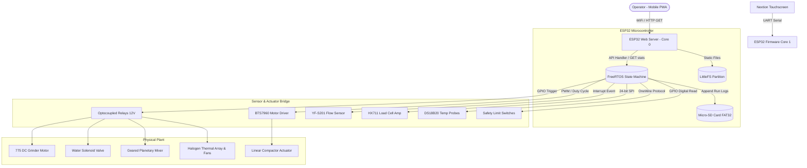

# System Design Document (SDD)

**Project:** Semi-Automated Paper-Charcoal Briquette Machine Embedded Architecture
**Date:** 2026-06-03
**Version:** 1.0.0
**Owner:** PUP Computer Engineering Group 6 (Añonuevo, Berongoy, Galdiano, Tiedra)
**PRD:** [PRD_Template.md](PRD_Template.md)

---

## 1. Architectural Vision & Principles

**Architecture style:**
Dual-Interface Edge IoT Node. The system relies entirely on localized edge processing on an ESP32-WROOM-32D microcontroller. The microcontroller concurrently runs a deterministic FreeRTOS finite state machine (FSM) for physical sensor/actuator control on Core 1, while Core 0 hosts a local Wi-Fi Access Point, broadcasts a DNS captive portal, and serves the static React PWA dashboard from its internal LittleFS flash partition.

```
       Core 1 [Control Core]                Core 0 [Network Core]
┌─────────────────────────────────┐  ┌─────────────────────────────────┐
│ • FreeRTOS State Loops          │  │ • Wi-Fi SoftAP Access Point     │
│ • Sensor Polling (HX711/Flow)   │  │ • WebServer (Async HTTP API)    │
│ • Actuation Relays/BTS7960      │  │ • LittleFS Static Asset Server  │
│ • SD Card Append-Only Logging   │  │ • DNS Captive Portal Server     │
└─────────────────────────────────┘  └─────────────────────────────────┘
```

**Guiding principles:**
*   **Separation of Concerns:** Core 1 handles timing-critical control loops (grinder, water valve, compactor safety checks). Core 0 handles network connections and web requests to prevent Wi-Fi stack operations from delaying hardware safety limit checks.
*   **Offline Independence:** No cloud dependency, external CDNs, or cellular gateways. The app must run 100% locally from the ESP32's flash.
*   **Safety Overrides:** Low-level safety limit switches trigger hardware interrupts that directly cut off motor drivers, bypassing the high-level dashboard.

**Key trade-offs made (V1 tech debt):**
*   **No Relational Database:** Because the ESP32 lacks the RAM/storage to run relational engines, we log data using flat append-only CSV files on a Micro-SD card. Data analysis must be compiled off-machine.
*   **Single-Client Write Lock:** Only one client (the Nextion Touchscreen or the PWA) can commit a "stage transition confirm" action at a time, preventing split-brain commands.

---

## 2. High-Level Architecture



**Layers:**

| Layer | Technology | Responsibility |
|-------|------------|----------------|
| **Client / HMI** | React.js + Vite (PWA) | Remote telemetry visual HUD, process stage confirmations. |
| **Local Host** | ESP32 SoftAP Web Server | Broadcasts localized Wi-Fi Access Point, serving offline assets. |
| **Edge Controller**| ESP32 Core 1 (FreeRTOS) | Executes FSM states, polls sensors, handles safety interrupts. |
| **Storage** | LittleFS & FAT32 Micro-SD | LittleFS stores web app files. SD card stores batch CSV logs. |
| **Actuator Drivers**| BTS7960 & Optocoupled Relays | Translates 3.3V logic signals into high-current 12V motor drives. |
| **Power Plant** | 100W Panel + 30Ah LiFePO4 | Off-grid power supply with solar charger telemetry. |

---

## 3. Data Architecture

### Filesystem Layout
*   **LittleFS (Internal Flash):** Stores `/index.html`, `/manifest.json`, `/sw.js`, `/registerSW.js`, and visual resources (JS/CSS bundles).
*   **Micro-SD Card (FAT32 External):** Mounted on `/sd` to support data logging.

### SD Card Data Schemas

**File: `/sd/production_runs.csv`** (Append-only)

| Field | Type | Constraint | Description |
|-------|------|------------|-------------|
| `batch_id` | unsigned long | PK (incrementing) | Unique identifier for the batch. |
| `timestamp` | char[20] | ISO 8601 string | Date and time of run initialization. |
| `grind_time_s` | unsigned int | >= 0 | Pulverization duration in seconds. |
| `water_vol_l` | float | >= 0.0 | Total water volume dispensed. |
| `mix_time_s` | unsigned int | >= 0 | Planetary mixer run duration. |
| `max_force_n` | float | 0.0 to 2500.0 | Peak compaction force recorded by HX711. |
| `dry_time_s` | unsigned int | >= 0 | Total duration of halogen curing. |
| `final_humidity` | float | 0.0 to 100.0 | Exhaust humidity recorded at termination. |
| `status` | char[6] | "OK" or "FAULT" | Termination status of the batch. |

**File: `/sd/system_events.csv`** (Append-only event log)

| Field | Type | Description |
|-------|------|-------------|
| `timestamp` | char[20] | Timestamp of event. |
| `level` | char[5] | "INFO", "WARN", "ERROR". |
| `source` | char[10] | "FSM", "NET", "SAFETY". |
| `message` | char[64] | Structured text message of the event. |

---

## 4. API Design & External Integrations

The web server utilizes `ESPAsyncWebServer` to process non-blocking API calls.

### API Endpoints

#### 1. System Telemetry Endpoint
*   **HTTP Method:** `GET`
*   **Path:** `/api/stats`
*   **Response (200 OK):**
```json
{
  "uptime_ms": 1420500,
  "free_heap": 182440,
  "total_heap": 327680,
  "clients": 2,
  "ssid": "Operator-Node-01",
  "channel": 6,
  "mac": "24:6F:28:AE:C2:1C",
  "ip": "192.168.4.1",
  "active_state": 3,
  "safety_switch": 1,
  "sensors": {
    "volumetric_flow_l": 2.45,
    "compaction_force_n": 1450.2,
    "curing_temp_c": 42.5,
    "relative_humidity": 24.1,
    "grinder_current_a": 4.2
  },
  "power": {
    "battery_voltage_v": 13.2,
    "solar_amperage_a": 2.1
  }
}
```

#### 2. Workflow Stage Transition Confirmation
*   **HTTP Method:** `POST`
*   **Path:** `/api/action`
*   **Payload (JSON):**
```json
{
  "action": "confirm_transition",
  "current_state": 3
}
```
*   **Response (200 OK):**
```json
{
  "status": "success",
  "next_state": 4
}
```

#### 3. Emergency Software Halt
*   **HTTP Method:** `POST`
*   **Path:** `/api/halt`
*   **Response (200 OK):**
```json
{
  "status": "halted",
  "reason": "operator_manual_trigger"
}
```

---

## 5. Security & Authorization

*   **Wi-Fi Access Control:** The ESP32 SoftAP is secured with WPA2-PSK encryption using a pre-shared key printed on the inside of the machine control panel.
*   **Local Routing Only:** The DNS server intercepts all domains (UDP Port 53) and issues a 302 redirect to `192.168.4.1` to ensure local captive portal loading.
*   **HMI Priority Lockout:** The Nextion physical touchscreen is connected via a hardwired UART connection and holds input priority. If a physical button is pressed, PWA dashboard controls are locked out for 5 seconds to prevent conflicting commands.

---

## 6. Infrastructure, CI/CD & Deployment

### Build Chain
*   **Embedded Firmware:** Compiled using PlatformIO inside VS Code using the ESP32 Arduino framework.
*   **Web Dashboard:** Built via Node.js Vite, outputting assets to the `operator-node/data` folder.

### Deployment Process
1.  Run `npm run build` inside `operator-node/dashboard/`. This outputs built files, including `sw.js` and `manifest.json`, to `operator-node/data`.
2.  Connect ESP32 via USB.
3.  Execute PlatformIO task: `Upload Filesystem Image` (this flashes the `data/` folder directly to the LittleFS flash partition).
4.  Execute PlatformIO task: `Upload` (flashes Core 0 and Core 1 firmware binaries).

---

## 7. Non-Functional Requirements

| Requirement | Target | Notes |
|-------------|--------|-------|
| **Telemetry Poll Latency** | < 250 ms | GUI response time during compaction force updates. |
| **Water Valve Cutoff** | < 50 ms | Max delay to close solenoid once 1:1 ratio is polled. |
| **Safety Interlock Shutdown** | < 5 ms | Core interrupt routine response to limit switch opening. |
| **Max Concurrent Mobile Connections** | 4 clients | Constraint of the ESP32 network stack. |
| **SD Write Retention** | 100,000 cycles | Flash wear-leveling handled by ESP32 SD library. |
| **Battery Cycle Endurance**| >= 10 batches | Single charge capacity on 30Ah LiFePO4 battery. |

---

## 8. AI / Agent Architecture

N/A — no AI components are integrated into the embedded firmware or web dashboard.

---

## Self-Check

- [x] Section 2 has an actual Mermaid diagram
- [x] Section 3 defines every entity with typed fields, keys, constraints
- [x] Section 3 has a forward-only migration strategy (append-only flat CSV file write versioning)
- [x] Section 7 latency/accuracy targets are specific numbers
- [x] Section 8 marked N/A
- [x] V1 shortcuts documented as explicit tech debt in Section 1 (CSV storage, single-client command lock)
- [x] This document answers *how* to build; *what* stays in [PRD_Template.md](PRD_Template.md)

---

*Next in sequence: [QAD_Template.md](QAD_Template.md) — QA and test plan.*
