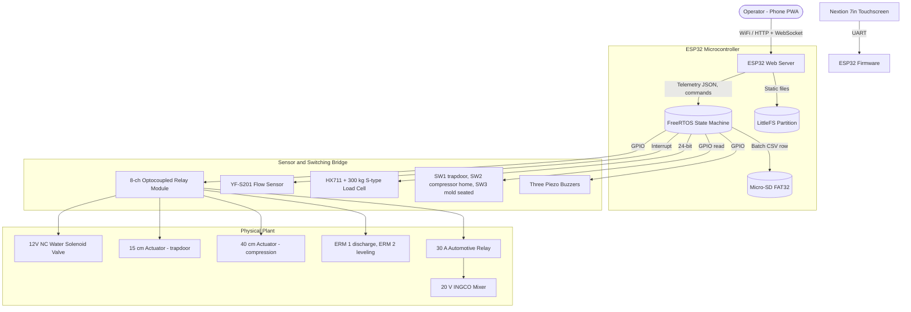

# System Design Document (SDD)

**Project:** AUTOBRIQ Fully Automated Paper-Charcoal Briquette Machine: Embedded Architecture
**Date:** 2026-10-19
**Version:** 1.1.0
**Owner:** PUP Computer Engineering Group 6 (Añonuevo, Berongoy, Galdiano, Tiedra)
**PRD:** [PRD_Template.md](PRD_Template.md)
**Build status and known gaps:** [PROJECT_CONTEXT.md](PROJECT_CONTEXT.md)

---

## 1. Architectural Vision & Principles

**Architecture style:**
Closed-loop, dual-interface edge IoT node on an ESP32-WROOM-32D (dual core, FreeRTOS). A finite state machine (FSM) runs the batch cycle from timers, sensor feedback and safety interlocks. The same node hosts a local Wi-Fi Access Point and serves a React PWA from internal LittleFS flash, and drives a Nextion 7" touchscreen over UART.

Core allocation (thesis): **Core 0** runs low-latency hardware ISRs and the fail-safe interlocks; **Core 1** runs the networking stack, the Wi-Fi AP and WebSocket telemetry. See section 9 for how the firmware currently differs.

```
        Core 0 [Control Core]                 Core 1 [Network Core]
┌─────────────────────────────────┐  ┌─────────────────────────────────┐
│ • Hardware ISRs (flow pulses,   │  │ • Wi-Fi SoftAP                  │
│   limit switches)               │  │ • Async HTTP server + WebSocket │
│ • Fail-safe interlocks          │  │ • LittleFS static asset server  │
│ • FSM, relay outputs            │  │ • DNS captive portal            │
│ • HX711 polling                 │  │ • Nextion UI and telemetry JSON │
│ • SD batch logging              │  │                                 │
└─────────────────────────────────┘  └─────────────────────────────────┘
```

**Guiding principles:**
*   **Separation of Concerns:** Timing-critical control (valve cutoff, compression stop, interlocks) must never wait on the network stack.
*   **Offline Independence:** No cloud, no external CDNs (fonts, icons, CSS frameworks), no cellular gateway. The PWA runs entirely from the ESP32's flash.
*   **One Output at a Time:** The FSM energises at most one machine output at any moment (`Outputs::driveOnly`), and the two relays of an actuator are never on together.
*   **Safety Overrides:** The emergency stop cuts the switched 12 V supply in hardware. The controller and touchscreen stay powered so the fault is displayed.

**Key trade-offs made:**
*   **No Relational Database:** The ESP32 lacks the RAM for SQL engines, so data is logged as flat append-only CSV on a Micro-SD card.
*   **Single Command Queue:** Commands from the touchscreen and from the PWA go into one queue and are applied in order by the FSM.
*   **Fixed Geometry:** One mold and one briquette size; the actuator stroke caps the slurry volume per cycle.

---

## 2. High-Level Architecture



**Layers:**

| Layer | Technology | Responsibility |
|-------|------------|----------------|
| **Physical Plant** | INGCO 20 V mixer, 15 cm and 40 cm 12 V linear actuators (1,500 N, 7 mm/s), solenoid valve, two ERM vibration motors | Performs the production steps |
| **Bridge** | YF-S201, 300 kg S-type load cell + HX711, three limit switches, 8-channel relay module, 30 A automotive relay, buzzers | Senses the machine and switches loads |
| **Edge Controller** | ESP32 FreeRTOS FSM | Runs the cycle, handles interlocks, logs batches |
| **Storage** | LittleFS and FAT32 Micro-SD | LittleFS holds the PWA files; SD holds batch CSV logs |
| **HMI** | Nextion NX8048T070 (UART) and React + Vite PWA | Batch start, status, readings, faults, CSV download |
| **Power Plant** | 110 W panel, EcoFlow RIVER 2 (256 Wh LiFePO4, MPPT), UME S2415 supply set to 20 V | Off-grid power: 12 V DC outlet for actuators and control, AC outlet to the mixer supply |

### Relay channel map (8-channel module)

| Channel | Load | Notes |
|---------|------|-------|
| CH1, CH2 | 15 cm actuator, extend / retract | Never both on (extend closes the trapdoor, retract opens it) |
| CH3, CH4 | 40 cm actuator, extend / retract | Extend presses, retract goes home |
| CH5 | Water solenoid valve | Normally closed valve; flyback diode across the coil |
| CH6 | 30 A automotive relay coil | Switches the mixer's 20 V supply |
| CH7, CH8 | Spare (see the open question about the ERM motors in [PROJECT_CONTEXT.md](PROJECT_CONTEXT.md)) | |

### Interlocks and faults

| Input | Meaning | When it matters | Fault action |
|-------|---------|-----------------|--------------|
| SW1 | Trapdoor closed | Before leveling and during compression | Unexpected open: stop production loads, fault state |
| SW2 | Compressor fully retracted (home) | Self-test, end of retraction | Home not reached: fault; at home the retract relay turns off |
| SW3 | Mold fully seated | Before and during compression; end of cycle | Mold removed mid-cycle: stop, fault. Mold removed after unload: return to setup |
| E-stop | Switched 12 V cut | Any time | Actuators and valve stop; controller and screen stay on |
| Force reading | HX711 validity and threshold | Compression | Invalid reading or timeout: stop, fault. Threshold reached: extend relay off |

---

## 3. Data Architecture

### Filesystem Layout
*   **LittleFS (Internal Flash):** `/index.html`, `/manifest.json`, `/sw.js`, `/registerSW.js` and the JS/CSS bundles. All assets are local.
*   **Micro-SD Card (FAT32 External):** mounted on `/sd` for logging. The NVS registry keeps state across power cycles (for example the next batch ID).

### SD Card Data Schemas

**File: `/sd/production_runs.csv`** (append-only, one row per batch)

| Field | Type | Constraint | Description |
|-------|------|------------|-------------|
| `batch_id` | unsigned long | PK (incrementing, kept in NVS) | Unique identifier for the batch. |
| `water_level_pct` | unsigned int | 30 to 100 | Water level selected by the operator. |
| `water_vol_l` | float | >= 0.0 | Water volume dispensed (YF-S201 count). |
| `runtime_s` | unsigned int | >= 0 | Elapsed time from START to batch completion. |
| `peak_force_n` | float | >= 0.0 | Peak compaction force recorded by the HX711. |
| `status` | char[6] | "OK" or "FAULT" | Termination status of the batch. |

**File: `/sd/system_events.csv`** (append-only event log)

| Field | Type | Description |
|-------|------|-------------|
| `uptime_s` | unsigned long | Seconds since boot (the ESP32 has no real-time clock). |
| `level` | char[5] | "INFO", "WARN", "ERROR". |
| `source` | char[10] | "FSM", "NET", "SAFETY". |
| `message` | char[64] | Structured text message of the event. |

---

## 4. API Design & External Integrations

The web server uses `ESPAsyncWebServer`. All endpoints are local to the SoftAP.

### HTTP

| Method | Path | Purpose |
|--------|------|---------|
| GET | `/` | Serves the PWA from LittleFS |
| GET | `/api/stats` | Current system and process snapshot (JSON, below) |
| GET | `/generate_204`, `/hotspot-detect.html`, `/connecttest.txt`, `/ncsi.txt` | Captive-portal probes from Android, iOS and Windows |

### WebSocket `/ws`

*   **Server to client:** the telemetry JSON below, sent on connect and then on a timer.
*   **Client to server:** small JSON commands `{"action":"<NAME>","payload":{...}}`.

| Action | Payload | Effect |
|--------|---------|--------|
| `SET_WATER` | `{"pct":80}` | Set the water level (setup screen only; 30 to 100, steps of 10) |
| `NEXT` / `BACK` | none | Move between the two setup screens |
| `START` | none | Begin the automatic cycle (from the charcoal screen) |
| `STOP` (alias `TRIP_SAFETY`) | none | Stop all outputs; state becomes STOPPED |
| `RESET` | none | From STOPPED, retract the press and close the trapdoor, then return to setup |
| `DONE` | none | Acknowledge unload and return to setup |

### Telemetry JSON (`/api/stats` and the WebSocket)

```json
{
  "uptime_ms": 1420500,
  "free_heap": 182440,
  "total_heap": 327680,
  "clients": 2,
  "ssid": "Operator-Node-01",
  "ip": "192.168.4.1",
  "channel": 6,
  "security": "WPA2-PSK",
  "process": {
    "step": "PRESS",
    "run_index": 8,
    "water_pct": 100,
    "target_l": 3.00,
    "flow_l": 3.00,
    "force_n": 1450,
    "peak_force_n": 1450,
    "step_elapsed_ms": 9000,
    "step_duration_ms": 0,
    "batch_ms": 241000
  },
  "outputs": {
    "solenoid": "OFF", "mixer_motor": "OFF", "gate_actuator": "OFF",
    "mixer_erm": "OFF", "box_erm": "OFF", "press_actuator": "EXTEND"
  },
  "power": { "battery_voltage_v": 12.9, "solar_amperage_a": 1.6 }
}
```

The thesis calls for 10 Hz telemetry; see section 9 for the current rate. Excerpted fields only: the full object also carries MAC, DNS counters and the remaining process fields.

---

## 5. Security & Authorization

*   **Wi-Fi Access Control:** WPA2-PSK. The key is set in firmware configuration and must be changed from the default before deployment.
*   **Local Routing Only:** The DNS server answers all names with `192.168.4.1` and the OS captive-portal probes are redirected, so the dashboard opens automatically.
*   **Client Limit:** The AP accepts up to 8 connections in firmware; the reliable range is 4 to 5 phones (thesis constraint).
*   **Command Arbitration (planned):** Touchscreen priority over the PWA (a short lockout of PWA controls after a touchscreen press) is a design goal and is not implemented yet.
*   **No outside access:** No WAN, cloud or cellular path exists.

---

## 6. Infrastructure, CI/CD & Deployment

### Build Chain
*   **Embedded Firmware:** PlatformIO in VS Code, ESP32 Arduino framework. Environments: `esp32doit-devkit-v1` (main firmware), `actuator-test` (relay bench test sketch), `nextion-test` and `nextion-bridge` (display bring-up tools).
*   **Web Dashboard:** Node.js + Vite builds to `operator-node/data`, which is flashed to LittleFS.

### Deployment Process
1.  Run `npm run build` inside `operator-node/dashboard/`. Output (including `sw.js` and `manifest.json`) goes to `operator-node/data`.
2.  Connect the ESP32 over USB.
3.  PlatformIO task `Upload Filesystem Image` (flashes `data/` to LittleFS).
4.  PlatformIO task `Upload` (flashes the firmware).
5.  Real relay outputs are off by default (`OUTPUTS_LIVE=0`); enable them only after the pin map matches the wiring.

---

## 7. Non-Functional Requirements

| Requirement | Target | Notes |
|-------------|--------|-------|
| **Telemetry Rate** | 10 Hz WebSocket (thesis) | Display update during compression force changes |
| **Water Valve Cutoff** | < 50 ms | Delay from reaching the preset volume to closing the valve |
| **Safety Interlock Shutdown** | < 5 ms | ISR response to a limit switch opening |
| **Concurrent Phones** | 4 to 5 reliable | SoftAP and ESP32 network stack limit |
| **Load Cell Resolution** | Limited by noise | Vibration from motors adds reading fluctuation; filter and read between vibration steps |
| **Water Volume Resolution** | One YF-S201 pulse | About 450 pulses per liter (calibrated by jug) |
| **Energy per Batch** | To be measured | EcoFlow RIVER 2 has 256 Wh; log it before claiming a batch count |
| **SD Logging** | Append-only CSV, FAT32 | No relational engine |

---

## 8. AI / Agent Architecture

N/A: no AI components are integrated into the embedded firmware or web dashboard.

---

## 9. Implementation Status

The firmware and the thesis differ in several places (limit switches, buzzers and SD logging not yet implemented; telemetry rate; core assignment; relay pin map; a mixer-pulse step). The authoritative list, with the action for each, is in [PROJECT_CONTEXT.md](PROJECT_CONTEXT.md) section 3.

---

## Self-Check

- [x] Section 2 has an actual Mermaid diagram
- [x] Section 3 defines every entity with typed fields, keys, constraints
- [x] Section 3 has a forward-only migration strategy (append-only CSV; new fields append as new columns at the end)
- [x] Section 7 targets are specific; numbers not yet measured are marked "to be measured"
- [x] Section 8 marked N/A
- [x] Trade-offs are documented in Section 1 (CSV storage, single command queue, fixed geometry)
- [x] Endpoints in Section 4 match the firmware
- [x] This document answers *how* to build; *what* stays in [PRD_Template.md](PRD_Template.md)

---

*Next in sequence: [QAD_Template.md](QAD_Template.md): QA and test plan.*
